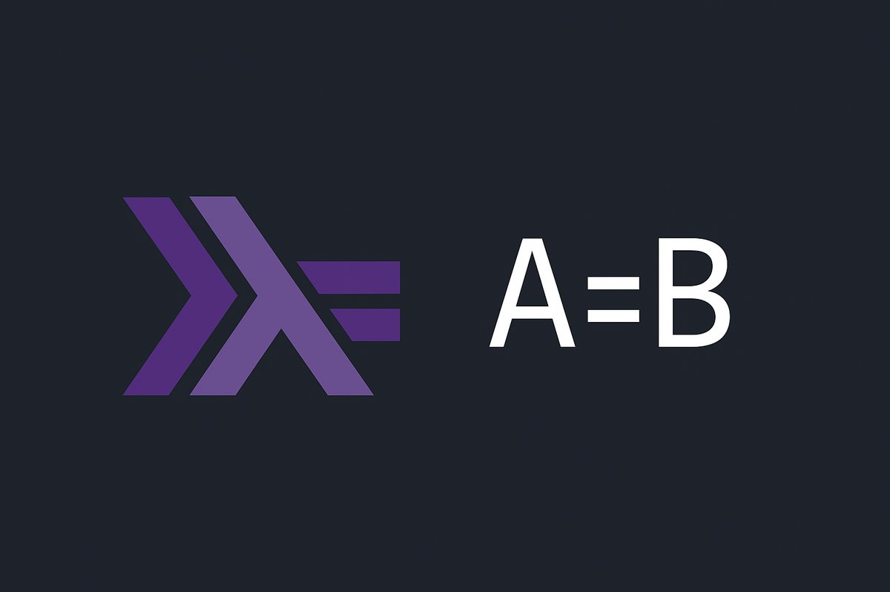

# A=B Interpreter

*Personal project · Mar – Apr 2025*

Haskell, Megaparsec, Stack

[Source on GitHub](https://github.com/edwardodp/haskell-atob)

An interpreter for A=B (pronounced "a to b"), an esoteric language whose only operation is text replacement. A program is a list of `find=replace` rules. The interpreter applies the first rule that matches the input string, jumps back to the top, and halts when no rule matches. A handful of keywords add control: `(start)` and `(end)` anchor a match or an insertion to either end of the string, `(once)` lets a rule fire only once, and `(return)` replaces and stops immediately.

## How it's built

- The parser is written with Megaparsec's parser combinators and handles comments, whitespace, keyword prefixes and the language's reserved characters.
- Interpretation itself is a pure function from the parsed rules and the input to the output.
- I extended the language slightly: `(once)` can be combined with `(start)` or `(end)`, which the original doesn't allow but which makes sense.
- There are 20 example programs, from palindrome checks to sorting, plus a test suite of input/output pairs. The interpreter handles all of the official A=B examples.

Written, as the README admits, when I definitely should have been revising for exams.
