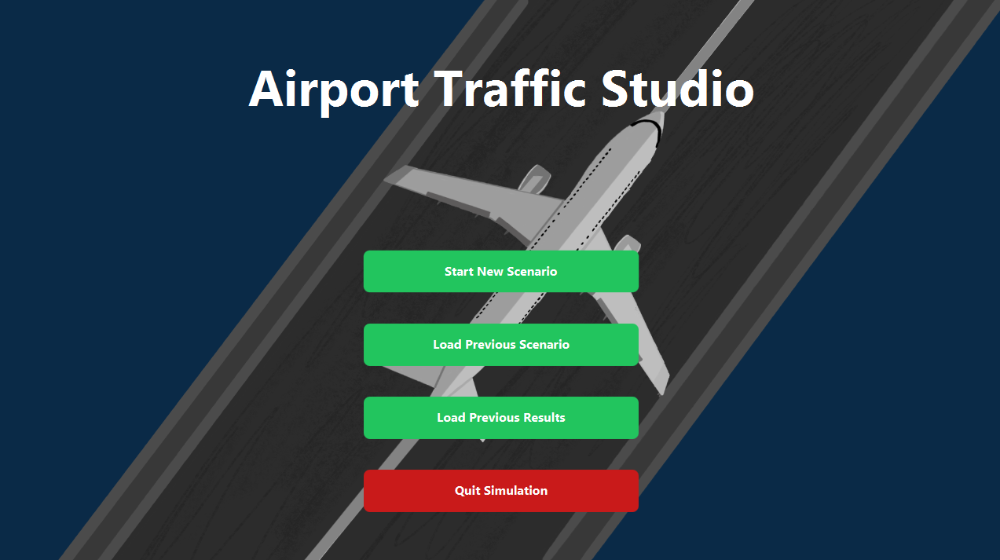
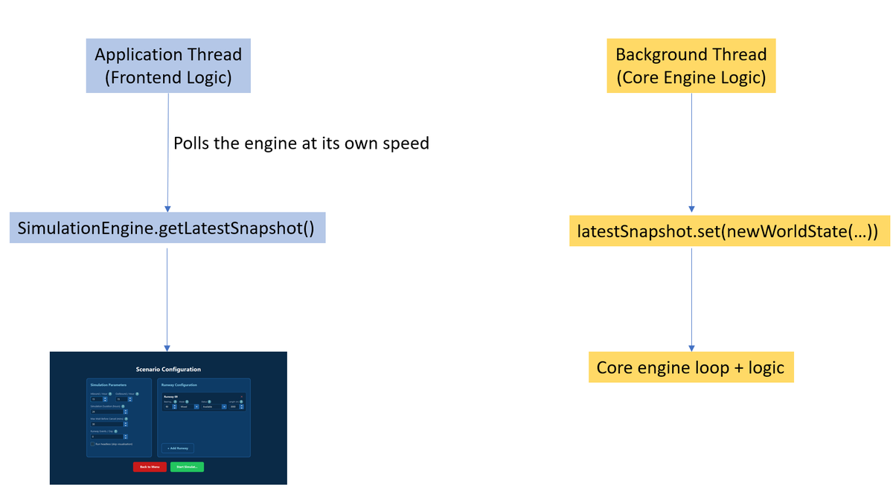
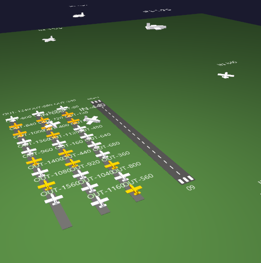

# Airport Traffic Studio

*Second-year software engineering group project · team of six · departmental prize · Jan – Mar 2026*

Java 21, JavaFX, Maven, JUnit 5

A discrete-time airport simulation, built over five one-week sprints against a simulated client brief from Dorset Software. You configure runways and traffic flow, watch the airport run live (or skip the visuals entirely), and get back delay, wait-time, throughput and safety statistics, with a side-by-side comparison of two runs. The project won a departmental prize. The repository is private, so this page is the write-up.

I led the architecture: I designed the class diagram the team built against, wrote almost all of the simulation engine and its threading, and built the headless mode. The full class diagram is [here](class-diagram.png).

## Immutable snapshots

The defining rule of the design was that the UI should never touch mutable simulation state. At the end of every tick (one simulated second), the engine produces a `WorldState` record made of immutable aircraft, runway and statistics snapshots, and the UI renders only from that. MVVM fell out of following that rule rather than being picked from a catalogue.

## Lock-free threading

The engine runs on its own thread while JavaFX renders on the application thread, polling for the latest snapshot every frame.

Because snapshots are immutable, sharing them needed no locks: the engine publishes each `WorldState` through an `AtomicReference`. User actions travel the other way through a `ConcurrentLinkedQueue` of commands, which the engine drains at the start of each tick, so state never changes mid-tick. Neither direction needs a mutex.

## Headless mode

One-second ticks mean a 30-day simulation is over 2.5 million ticks. For batch analysis I added a headless mode that skips snapshot creation and rendering, and samples statistics every 60 ticks instead of every tick. With far less allocation for the garbage collector to deal with, a 720-hour simulation runs in about 0.3 seconds.

## The rest of the system

- A holding pattern that prioritises emergencies (fuel, then mechanical, then medical) and otherwise orders by arrival time. Aircraft burn fuel while holding, declare an emergency below ten minutes of fuel, and divert if no runway frees up in time.
- Runway closures and random runway events (inspections, snow clearance, equipment failure), with flights cancelled after a configurable maximum wait.
- Real airports loaded from the OurAirports dataset, and a 3D view of the airport built by a teammate.
- 336 JUnit tests passing, at roughly 80% line coverage.

## What I'd do differently

Early on I tried to control too much of the system myself. I changed approach and spent more of my time explaining the design so teammates could build against it independently, and by the middle sprints they were extending the architecture without me. I still wrote too much of the core engine myself, which left the team dependent on me for it. Next time I'd hand core pieces to others earlier.
