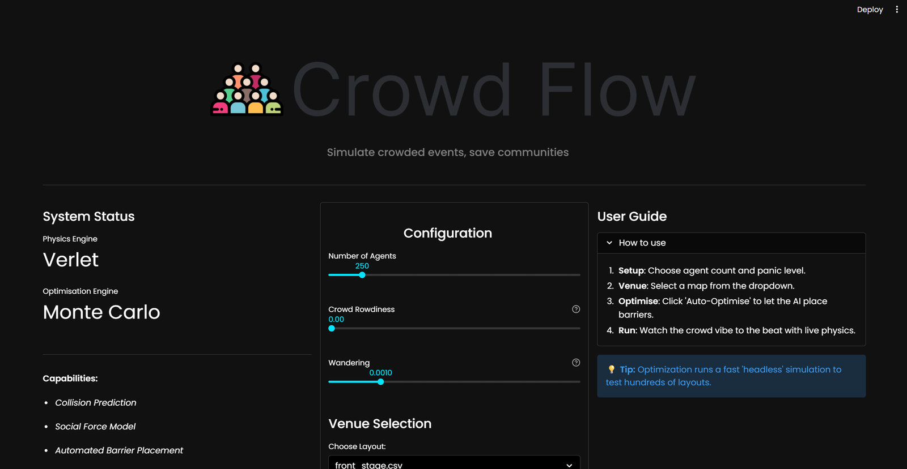
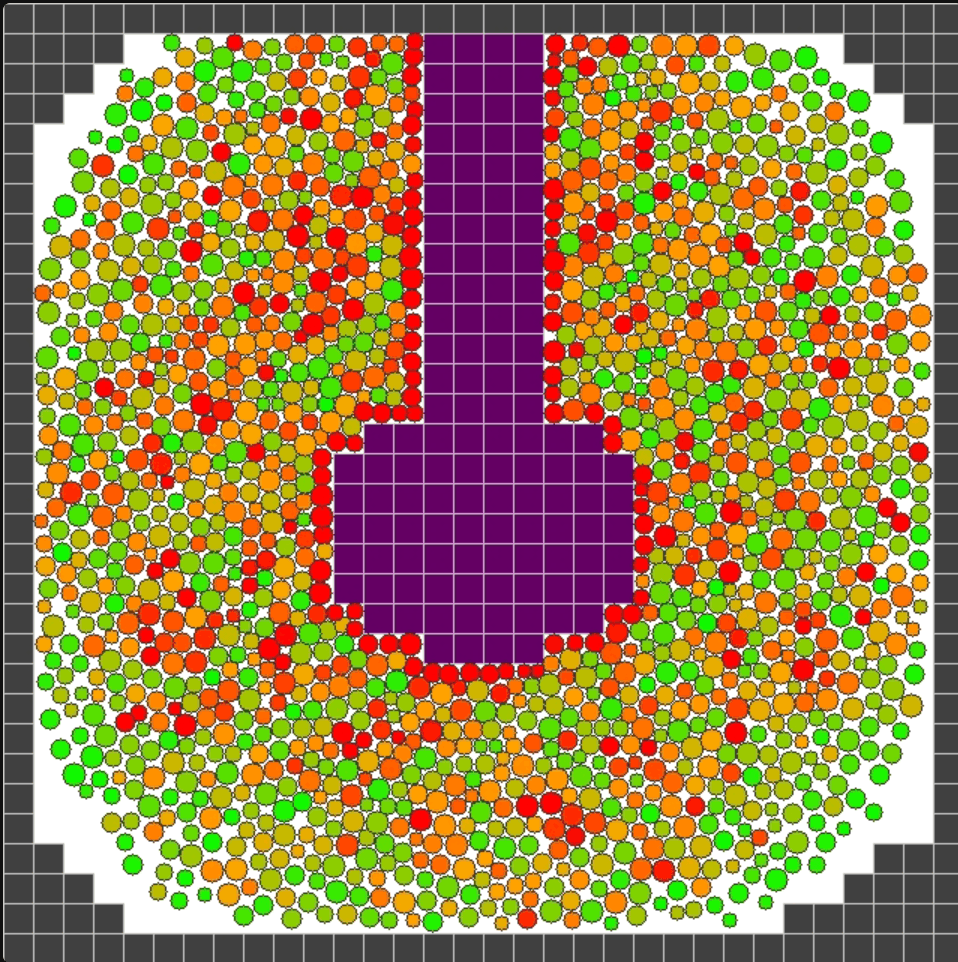

# Crowd Flow

*AstonHack 11 · built in 24 hours with Jakub Kisielewski · Feb 2026*

Python, Numba, NumPy, Librosa, Streamlit

[Source on GitHub](https://github.com/edwardodp/crowd-flow)

Crowd disasters like the 2021 Astroworld crush and the 2022 Seoul Halloween crush weren't unpredictable; they were failures of planning. Crowd Flow lets an organiser simulate a venue at high density, see where pressure builds up, and search for barrier layouts that relieve it. I wrote most of the physics engine and the optimiser; Jakub built most of the Streamlit app.

## Physics

Each person is an agent driven by a social force model: a pull towards where they want to go, repulsion from the people around them, and contact forces when they collide, integrated with Verlet integration. Two things make it fast enough to run 2,000+ agents at 60 FPS. Numba JIT-compiles the hot loops to machine code, and cell-list spatial partitioning cuts the neighbour search from O(N²) to O(N), since each agent only checks the cells around it.

## Barrier optimisation

Spotting a choke point is half the problem; fixing it is the other half. A Monte Carlo search tries hundreds of barrier layouts built from strategies like funnels, wave-breakers and islands, scores each one with a fast headless simulation, and keeps whichever minimises average crowd pressure. The best layouts cut average pressure by around 60%.

## Music-reactive crowds

Crowds react to what's playing. Audio analysis of energy, onsets and tempo adjusts how rowdy the crowd is, so a layout can be stress-tested against an actual setlist.
